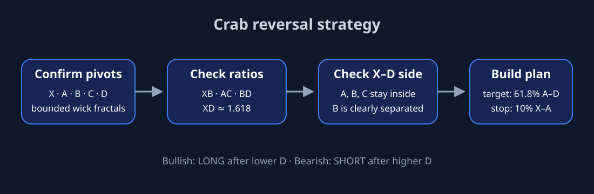
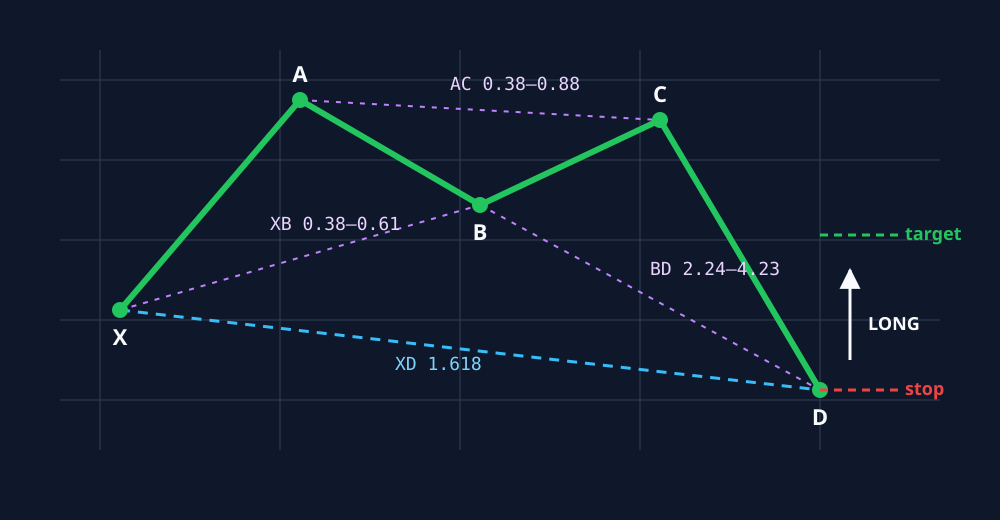

# @tradejs/strategy-crab

TradeJS strategy plugin providing `Crab`.

## Strategy overview

`Crab` detects a five-pivot harmonic reversal pattern in both directions:

1. `X → A` defines the initial impulse;
2. `B` retraces 38–61% of `X → A`;
3. `C` retraces 38–88% of `A → B`;
4. `D` extends `B → C` by 224–423%;
5. `A → D` is close to 161.8% of `X → A`.

The bullish form uses `low → high → low → high → lower low` and becomes a
LONG reversal candidate after D is confirmed. The bearish form is its exact
mirror and becomes a SHORT candidate.



## Ratio notation

Harmonic charts commonly draw guide lines between point names while reporting
the ratio of the two adjacent legs. This package keeps the chart labels and
calculates them as follows:

- `XB = AB / XA`, default range `0.38–0.61`;
- `AC = BC / AB`, default range `0.38–0.88`;
- `BD = CD / BC`, default range `2.24–4.23`;
- `XD = AD / XA`, ideal value `1.618` with a configurable 5% tolerance.

The detector also requires A, B, and C to stay inside the X–D boundary. B must
be visibly separated from that line, which helps distinguish a Crab from a Bat.



The illustrations are schematic. Defaults use wick pivots and a two-bar
confirmed fractal. A signal is emitted only after D is confirmed, so the
strategy does not assume an entry at the historical D price. The default target
is a 61.8% retracement of A–D from D, and the stop is 10% of X–A beyond D.
Every tolerance is explicit in the strategy config so research can change the
geometry without changing detector code.

## Install

```bash
yarn add @tradejs/strategy-crab
```

To install the latest verified preview, run:

```bash
yarn add @tradejs/strategy-crab@beta
```

Register the package in `tradejs.config.ts`:

```ts
import { defineConfig } from "@tradejs/core/config";

export default defineConfig({
  strategies: ["@tradejs/strategy-crab"],
});
```

The package exports `strategyEntries`, the `Crab` strategy definition,
manifest, default config, and AI adapter. The adapter carries Crab geometry to
the AI payload but intentionally has no unvalidated local gate.

## Development

```bash
yarn install --immutable
yarn checks
```

Publishing is beta-first and delegated to the pinned
`TradeJS-Workflows@v1` reusable workflow.

## Runtime host contract

All `@tradejs/*` runtime packages are peer dependencies. The consuming TradeJS
Project owns their exact installed versions and package manifest, so this
package never loads a hidden nested engine, types package, or Strategy Kit.
